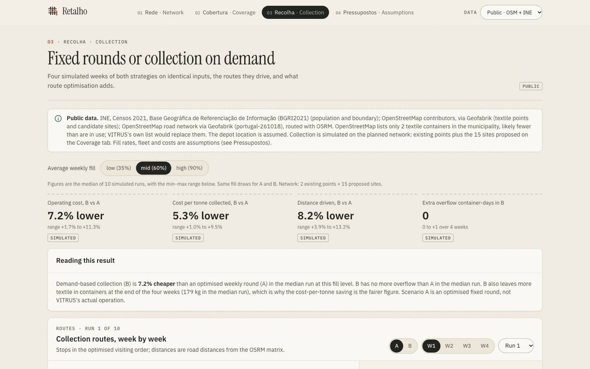
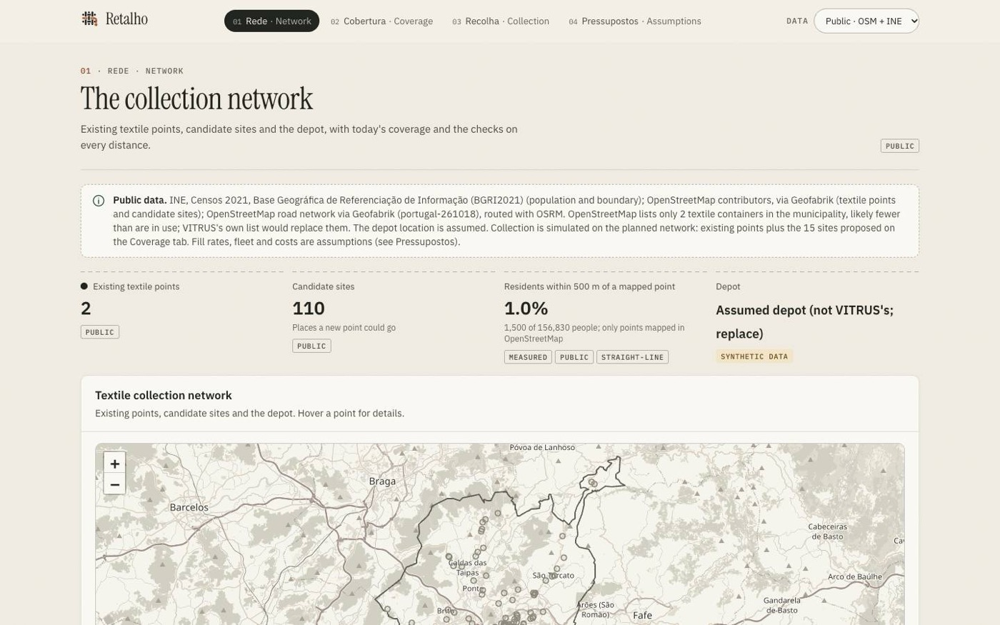
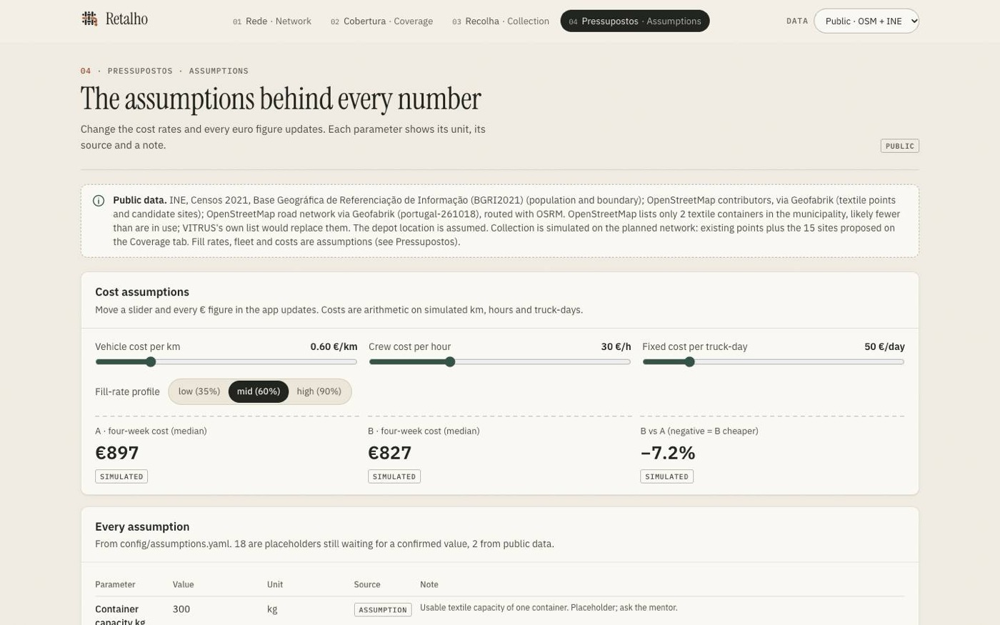
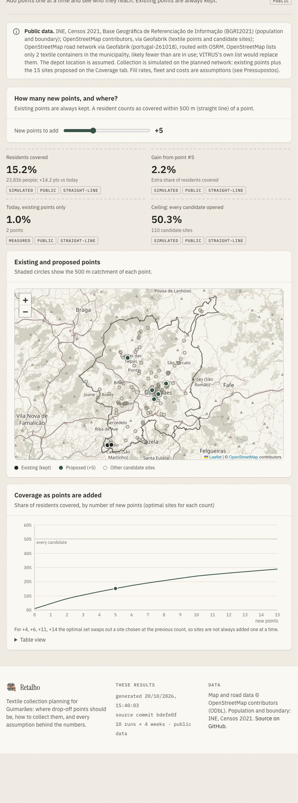
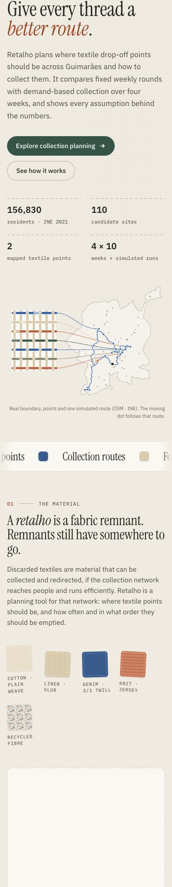
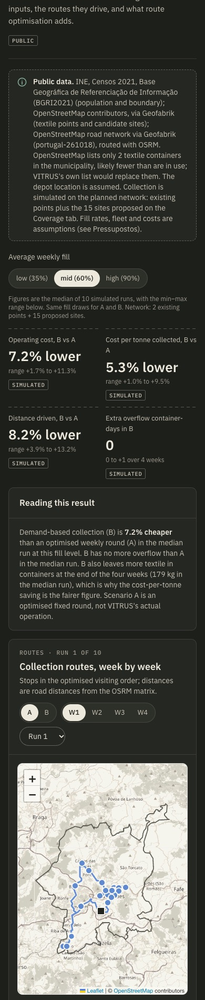
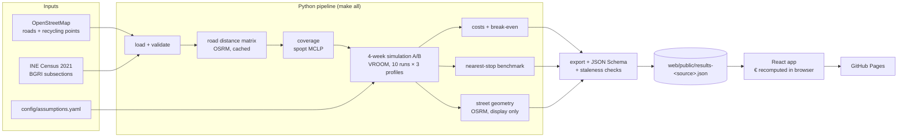

<p align="center">
  
</p>

<h1 align="center">Retalho</h1>

<p align="center"><b>Textile collection planning for Guimarães.</b><br>
Decide where textile drop-off points should be and how to collect them. Fixed weekly rounds are compared with demand-based collection over four weeks, on real roads, with every assumption in view.</p>

<p align="center">
  <a href="https://bhavya-jpg.github.io/retalho/"><b>Open the live app</b></a> ·
  <a href="#a-tour-of-the-planner">Tour</a> ·
  <a href="#getting-started">Getting started</a> ·
  <a href="#how-it-works">How it works</a> ·
  <a href="#data-and-provenance">Data</a> ·
  <a href="#limitations">Limitations</a>
</p>


In Portuguese, a *retalho* is a remnant of fabric. Retalho treats discarded textiles as material that still has a next destination, provided the collection network reaches people and runs efficiently.

---

## Contents

1. [What Retalho is](#what-retalho-is)
2. [A tour of the planner](#a-tour-of-the-planner)
3. [Features](#features)
4. [Screenshots](#screenshots)
5. [Design](#design)
6. [How it works](#how-it-works)
7. [Methodology](#methodology)
8. [Data and provenance](#data-and-provenance)
9. [Results so far](#results-so-far)
10. [Getting started](#getting-started)
11. [Configuration](#configuration)
12. [Testing and quality assurance](#testing-and-quality-assurance)
13. [CI and deployment](#ci-and-deployment)
14. [Project structure](#project-structure)
15. [Troubleshooting](#troubleshooting)
16. [Limitations](#limitations)
17. [Roadmap](#roadmap)
18. [Background](#background)
19. [Licences and credits](#licences-and-credits)

## What Retalho is

Textile collection forces two decisions that pull against each other:
- **Coverage:** points must be close enough for residents to use.
- **Efficiency:** trucks should not drive to half-empty containers, nor leave full ones overflowing.

Retalho is a planning tool for that trade-off, built around the textile collection network of Guimarães, Portugal. It is designed for collection operators such as VITRUS, for municipal planners, and for anyone evaluating textile collection in the city.

**It answers four questions**
1. **Where are textile points today, and who can reach them?** Population within a chosen distance of a point.
2. **Where should new points go?** The sites that cover the most residents, always keeping existing points.
3. **How should they be collected?** Four simulated weeks of two strategies on road distances:
   - **A · fixed weekly rounds:** every container is emptied every week, on optimised routes. This is a fair baseline, not VITRUS's actual operation.
   - **B · demand-based collection:** a container is emptied only when its projected fill would reach a threshold *T* (80% by default) before the next weekly run.
4. **What does each answer rest on?** Every input and parameter shows its unit, source and status, and cost rates can be changed live.

**What Retalho does not do**
- It does not collect, sort, recycle or process textiles, and it does not track real trucks or containers.
- It holds no real-time data, and no VITRUS operational data yet.
- Every collection result is a **simulation under stated assumptions**, not a measured saving. The interface labels each figure accordingly.

## A tour of the planner

The app is a single static page. Each view has its own URL fragment, so links and refreshes keep you where you were.

| View | URL | What you can do |
|---|---|---|
| **Home** | `#inicio` | The story in six sections, using the real data: the material, the city, the strategies (as a woven calendar), the evidence, the transparency, and links into the planner |
| **01 Rede · Network** | `#rede` | See existing textile points, candidate sites and the depot on the map, today's coverage, and the checks on every road distance |
| **02 Cobertura · Coverage** | `#cobertura` | Drag the **+N new points** slider (0–15). The map shows the proposed sites and their 500 m catchments, with coverage %, the gain from the N-th point, the ceiling, a coverage curve and a table view |
| **03 Recolha · Collection** | `#recolha` | Compare A and B (see below) |
| **04 Pressupostos · Assumptions** | `#pressupostos` | Move the €/km, €/crew-hour and €/truck-day sliders and every euro figure updates. Lists every parameter with its value, unit, source badge and note, plus data sources and licences |

**In the Collection view**
- **Fill profile:** pick low (35%), mid (60%) or high (90%) average weekly fill.
- **Headline figures:** four tiles compare B with A (operating cost, cost per tonne, distance, extra overflow), each a median with its min–max range over 10 runs.
- **Reading this result:** a plain-language summary that applies the overflow rule; a cheaper strategy does not "win" if it overflows more.
- **Routes, week by week:**
  - Choose scenario A or B, week W1–W4 and run 1–10.
  - Routes follow the streets, and a truck marker drives each truck-day in visiting order.
  - Click a stop, on the map or in the truck-day list, for its type, capacity, the weeks it was collected and its position in the route.
  - A **collection calendar** beside the map shows the same run as a woven grid of containers × weeks.
- **Four-week totals:** cost, cost per tonne, km, crew hours, stops, truck-days, kilograms, overflow and textile left at week 4, with paired bars.
- **Distance per week:** a chart with a table view.
- **Optimisation value:** Retalho's routes against a nearest-stop baseline on identical inputs, for A or B.
- **Break-even:** B's saving against average weekly fill, as total cost or per tonne, with the current profile marked.

The header switches between the **public** dataset (the default) and the **synthetic** demo dataset.

## Features

All of these are implemented and tested.

**Planning model**
- **Coverage optimisation:** spopt's maximal covering location model (MCLP), solved exactly with CBC. Population-weighted; existing points always kept; +0 to +15 sites.
- **Four-week simulation of both strategies:**
  - identical fill draws, starting fills, matrix and fleet, enforced by fingerprint
  - a mass-balance check on every run
  - 10 runs × 3 fill profiles
- **Routing:** pyvroom vehicle routing with capacity, shift length and service time. It never leaves a stop unserved, and names the reason when it cannot fit one.
- **Costs:** the same cost model in Python and in the browser, with parity tested.
- **Break-even:** a sweep over seven average fill levels.
- **Optimisation-value benchmark:** a deterministic nearest-stop router replays the same four weeks with identical stops, loads, fleet and costs. Improvements are signed, never clamped, and "unavailable" when the baseline is zero.

**Maps and routes**
- **Road distances and street geometry** from OSRM, embedded at build time. The site calls no routing service.
- **Approximate geometry is always labelled.** Where street geometry is unavailable, routes fall back to dashed straight segments marked approximate; dashes mean nothing else on the map.
- **Selectable stops** with details from the data, keyboard-accessible truck-day stop lists, and animated trucks on routes.
- **Offline-tolerant:** if the base-map tiles fail, boundary, points and routes stay exact on a plain background.

**Transparency**
- **Labels on every figure:** Measured, Simulated, Assumption, Public, Synthetic data, Straight-line or Approx. distances.
- **Provenance:** a banner on every view states which inputs are public, synthetic or assumed. Each dataset records the code commit that produced it.
- **Source reports** list what changed between datasets.

**Product**
- **Textile identity:** woven swatches, a data-driven hero and a collection weave.
- **Continuous, purposeful motion** (see [Design](#design)).
- **Light and dark themes,** responsive from 360 px phones to wide desktops, with no horizontal scrolling.
- **A single-file offline build** for presentations, with data and fonts embedded.
- **Six interface languages:** English, Português, Español, Français, Deutsch and Italiano. Pick one in the header (on phones it shows the language code), or link with `?lang=pt`. The choice is remembered in the browser. Numbers, euros and dates follow the language.

## Screenshots

Genuine captures of the production build, served under `/retalho/` exactly as on GitHub Pages.

| | |
|---|---|
|  |  |
| **The collection weave.** One simulated run drawn as cloth: rows are containers, columns are weeks. | **Routes, week by week.** Street routes on a warm paper map, beside the calendar for the same run. |
|  |  |
| **Collection.** B against A over four weeks, median and range over 10 runs. | **Optimisation value.** Same inputs, two routing methods, paired per run. |
|  |  |
| **Network.** Existing points, candidate sites, depot and distance checks. | **Assumptions.** Live cost sliders and every parameter with its source. |

<p align="center">
  
  &nbsp;
  
  &nbsp;
  
  <br><sub>Tablet (768 px) · phone, light theme (390 px) · phone, dark theme (390 px)</sub>
</p>

## Design

The visual direction is **"tecido urbano" (urban fabric)**: the city's streets as warp, collection routes as weft. The research behind it is in [docs/DESIGN_RESEARCH.md](docs/DESIGN_RESEARCH.md): the sites inspected at desktop and mobile widths, measured motion timings, and what was deliberately not copied.

**Colour.** Tokens live in [web/src/index.css](web/src/index.css):

| Role | Token | Light | Notes |
|---|---|---|---|
| Canvas / surfaces | `--cotton`, `--ivory`, `--oat` | `#F3EFE6`, `#FAF8F2`, `#ECE6D9` | Undyed fibres, with a fibre-grain overlay |
| Ink | `--ink`, `--ink-2`, `--muted` | `#22241F`, `#4A4A42`, `#66645A` | All ≥ 5.1:1 on cotton |
| Accent | `--forest` | `#355447` | Buttons, links and proposed sites; never a strategy |
| Strategy A | `--series-a` (indigo) | `#2F5C9E` (dark `#5F8AD0`) | Validated with B for chroma, colour-vision separation and contrast |
| Strategy B | `--series-b` (terracotta) | `#B65E3B` (dark `#D2724B`) | Marks only; text uses `--terracotta-ink` `#9A4A2C` |
| Lines | `--flax`, `--border` | `#D8C8AC` | Woven grid, stitched seams |

**Typography.** Instrument Serif for display, IBM Plex Sans for the interface, IBM Plex Mono for ids, units and provenance. All three are OFL-1.1, self-hosted with relative paths and embedded in the offline build.

**Graphics.** All original SVG:
- a woven logo whose loose thread becomes a route to a collection point (also the favicon)
- five textile swatches (cotton, linen, denim, knit, recycled fibre)
- a hero drawn from the real boundary, network and one simulated route
- the collection weave
- journey, pipeline and visiting-order diagrams, labelled conceptual where they are not data

**Motion.** Everything moves because it represents something real:

| Element | Behaviour |
|---|---|
| Hero | Threads draw once; a truck drives the real simulated route; a shuttle glint passes along each weft thread; cloth and city drift apart with the pointer |
| Landing figures | Count up once when they come into view; screen readers get the final value immediately |
| Ribbon | A woven selvedge ribbon drifts continuously and stops while hovered |
| City and calendar | Proposed sites ripple; a playhead steps W1 → W4 across both strategy weaves, and hovering a row highlights that container in both |
| Pipeline diagram | Data packets travel from inputs to the app |
| Planner | Routes draw once per scenario, week or run change; trucks drive each truck-day (only while the map is on screen); the navigation pill slides; views fade in |

Timing tokens are 150 / 300 / 600 / 900 ms. **Animations are always on, by product decision.** There is no pause control and the operating system's reduced-motion setting is not applied, so the site does not meet WCAG 2.2.2 (Pause, Stop, Hide). Content never depends on animation to be visible.

**Accessibility.** On 20 Oct 2026, an axe-core audit (WCAG 2.1 A/AA and best-practice rules) of all five views in both themes reported no violations. That audit does not test the pause requirement above.
- Strategies are identified by label, not by colour alone.
- Map stops are reachable from keyboard-accessible lists.
- Headings are ordered and controls named; a skip link and visible focus outlines are provided.

## How it works



An offline Python pipeline computes everything into versioned JSON, one file per dataset. The browser loads only that static JSON. Euro figures are computed client-side from physical quantities (km, crew hours, truck-days), which is why the cost sliders respond instantly and why no backend is needed.

| Step | Module | What it does |
|---|---|---|
| Load | [pipeline/load.py](pipeline/load.py) | Validates containers, candidates, demand points, depot and boundary against a data contract (unique ids, inside the boundary, valid capacity and population, a source label on every record). Reports every problem at once and writes nothing until all are fixed |
| Distances | [pipeline/matrix.py](pipeline/matrix.py) | Road distance and car time from a local OSRM server, cached by points and OSM data version. Falls back to straight line × detour factor, labelled `approx` everywhere, if OSRM is unavailable |
| Coverage | [pipeline/coverage.py](pipeline/coverage.py) | Population share within `coverage_radius_m` (straight line), and the optimal +N additions |
| Simulation | [pipeline/simulate.py](pipeline/simulate.py), [pipeline/solve.py](pipeline/solve.py) | Four weeks of A and B, routed weekly with pyvroom |
| Costs | [pipeline/cost.py](pipeline/cost.py), [web/src/lib/cost.ts](web/src/lib/cost.ts) | Cost model, paired savings, break-even sweep |
| Benchmark | [pipeline/benchmark.py](pipeline/benchmark.py) | Nearest-stop baseline on identical weeks |
| Geometry | [pipeline/geometry.py](pipeline/geometry.py) | OSRM street paths per distinct stop sequence: validated, cached, simplified. Display only; never changes order or distance |
| Export | [pipeline/export.py](pipeline/export.py) | One JSON per dataset, validated against [schema/results.schema.json](schema/results.schema.json). Refuses stale inputs and records the source commit |

## Methodology

**Fill model**
- Each container's average weekly fill is drawn from a gamma distribution for the chosen profile (mean ± spread).
- Each week varies around it with coefficient of variation `fill_weekly_cv`.
- Fill accumulates daily, and an *overflow container-day* is any day a container ends above 100%.

**Collection**
- Collection happens at the start of each week.
- Each vehicle is one truck for one working day: capacity `truck_capacity_kg`, shift `shift_h`, `service_min_per_stop` per stop, travel times scaled by `truck_speed_factor`.
- A week offers `trucks × collection_days_per_week` truck-days.
- VROOM minimises the same cost the app reports.

**Fairness**
- A and B receive identical fill draws, starting fills, distance matrix and fleet, checked by fingerprint.
- No stop may be left unserved.
- Kilograms left in containers at week 4 are reported for both, so B cannot look cheaper by postponing collection.

**Costs**
```
operating cost = km × €/km + crew hours × €/h + truck-days used × €/truck-day
cost per tonne = operating cost ÷ tonnes collected
saving of B    = (cost A − cost B) ÷ cost A, per run, then median and range
```

**Benchmark**
- **The baseline:** for each truck-day, keep driving to the nearest unvisited stop by road distance (ties broken by id) that still fits the remaining capacity and shift.
- **Identical inputs:** the four weeks are replayed with that router, so stops, kilograms and overflow are identical by construction, and this is asserted every week.
- **The formula:** improvement = (baseline − optimised) ÷ baseline.
- **What it means:** nearest-stop is a simple baseline, not the best possible alternative.

**Coverage**
- A resident is covered within `coverage_radius_m` straight-line metres of a point.
- MCLP chooses N candidate sites to add, keeping all existing points.
- The optimal set for N+1 does not always contain the set for N; the app says when that happens.

## Data and provenance

| Input | Public dataset (default) | Label |
|---|---|---|
| Boundary | Union of INE BGRI 2021 subsections for Guimarães (municipality code 0308) | Public |
| Population | 2,382 census subsections, **156,830 residents** (INE Censos 2021) | Public |
| Existing textile points | OpenStreetMap `recycling:clothes=yes`: **only 2** inside the municipality | Public |
| Candidate sites | 110 other OSM recycling containers, de-duplicated within 15 m | Public |
| Depot | Assumed location ([config/public_source.yaml](config/public_source.yaml)) | Synthetic |
| Roads | OSM via Geofabrik (Portugal, 18 Oct 2026), routed with OSRM v6 | Public |

**The planned network.** OpenStreetMap almost certainly lists fewer textile containers than are in use. Collection is therefore simulated on a planned network: the existing points plus the 15 sites the coverage optimiser proposes (`collection_network_new_points`; 0 means existing points only).

**The synthetic dataset.** [pipeline/synthetic.py](pipeline/synthetic.py), seed 2035: 30 containers, 60 candidates and 400 demand points, all generated and labelled synthetic throughout. It demonstrates the method on a denser network and does not describe Guimarães.

**Provenance**
- Each results file records its source commit (currently `f3fdb42`), generation time, distance provider and data sources. The app footer shows them.
- `out/source_report_<source>.md` lists which inputs and assumptions differ between datasets.

**VITRUS data** has not been supplied. [docs/VITRUS_DATA.md](docs/VITRUS_DATA.md) is the intake procedure:
1. `make vitrus-init` prepares the git-ignored `data/raw/vitrus/` folder without inventing anything.
2. Fill it with VITRUS's files and record their provenance.
3. `make all SOURCE=vitrus` reruns everything.

## Results so far

Simulated, from results commit `f3fdb42`, public dataset unless noted. These are model outputs under the assumptions listed in [Configuration](#configuration), not measured VITRUS operations.

| Question | Result (median over 10 runs) |
|---|---|
| Residents within 500 m of a mapped textile point today | 1.0% (2 OSM points: Measured) |
| … with +15 optimised sites | 28.9% (Simulated) |
| Operating cost of B vs A at mid fill (60% per week) | B 7.2% lower (range 1.7–11.3%); no extra overflow in the median run |
| Break-even sweep | B's saving falls from 60% at 20% weekly fill to under 1% at 110% |
| Optimised routes vs nearest-stop, operating cost | 2.9–7.1% lower across profiles and strategies; lower in all 60 runs |
| … synthetic dataset | 9.8–14.0% lower; lower in all 60 runs |

B also leaves more textile in containers at the end of the four weeks, which is why the app reports cost per tonne alongside total cost.

## Getting started

**Requirements**
- [uv](https://docs.astral.sh/uv/) (Python 3.12+; the project pins 3.13)
- Node 20.19+ or 22.12+
- Docker, only to build road data with OSRM and to rebuild the public dataset

**Run the app with the committed results**

```sh
cd web
npm ci
npm run dev            # http://localhost:5173
```

**Rebuild everything from raw data**

```sh
make install           # Python (uv) and web (npm) dependencies
make check-env         # versions, and proof that the VROOM and CBC solvers run
make osrm              # download the OSM extract once (426 MB), build and start OSRM on :5050
make public-data       # data/raw/public from OpenStreetMap + INE Census 2021
make all SOURCE=synthetic
make all SOURCE=public # built last, so it is the app's default dataset
make web
```

**Make targets**

| Target | What it does |
|---|---|
| `make install` | Install Python and web dependencies |
| `make check-env` | Print versions and run a tiny VROOM and CBC solve |
| `make public-data` | Build `data/raw/public` from OSM + INE (Docker) |
| `make vitrus-init` | Prepare the git-ignored `data/raw/vitrus/` for VITRUS files |
| `make data SOURCE=…` | Validate a raw source into `data/clean/` |
| `make osrm` / `osrm-build` / `osrm-down` | Start, rebuild or stop the local OSRM server |
| `make matrix` | Build or read the cached distance matrix (`PROVIDER=auto\|osrm\|approx`) |
| `make coverage` · `simulate` · `cost` · `benchmark` · `geometry` | Run one pipeline stage |
| `make export` | Assemble, validate and publish the results JSON |
| `make all SOURCE=…` | Data plus every stage plus export, in one command |
| `make test` | Python tests |
| `make web` · `web-build` · `offline` | Dev server, static build, single-file offline build |
| `make docker-check-env` | Run the pipeline check in a `python:3.12-slim` image (for machines without a pyvroom wheel) |
| `make clean` | Remove generated data and caches |

## Configuration

**Model parameters** live in [config/assumptions.yaml](config/assumptions.yaml), each with a value, unit, source and note. Change a value, rerun `make all`, and the export refuses any stale stage output.

| Parameter | Value | Unit | Source |
|---|---|---|---|
| `container_capacity_kg` | 300 | kg | assumption |
| `fill_rate_profiles` | low 35% ± 15, mid 60% ± 20, high 90% ± 25 | share of capacity per week | assumption |
| `fill_weekly_cv` | 0.3 | coefficient of variation | assumption |
| `threshold_T` | 0.8 | share of capacity | assumption |
| `collection_network_new_points` | 15 | count | assumption |
| `collection_days_per_week` | 5 | days/week | assumption |
| `trucks` | 2 | count | assumption |
| `truck_capacity_kg` | 2,500 | kg | assumption |
| `truck_speed_factor` | 0.8 | ratio | assumption |
| `shift_h` | 8 | h | assumption |
| `service_min_per_stop` | 5 | min | assumption |
| `cost_per_km` | 0.60 | €/km | assumption |
| `crew_cost_per_h` | 30 | €/h | assumption |
| `fixed_cost_per_truck_day` | 50 | €/truck-day | assumption |
| `new_point_cost` | unknown | €/point | assumption |
| `coverage_radius_m` | 500 | m | assumption |
| `detour_factor` | 1.42 | ratio | public (calibrated with OSRM) |
| `fallback_speed_kmh` | 45 | km/h | public (calibrated with OSRM) |
| `seeds` | 10 | runs | assumption |
| `horizon_weeks` | 4 | weeks | assumption |

**Other configuration**
- [config/public_source.yaml](config/public_source.yaml): the public dataset build (municipality code, de-duplication distance, the assumed depot).
- [config/synthetic.yaml](config/synthetic.yaml): the synthetic generator.
- [config/benchmarks.yaml](config/benchmarks.yaml): external benchmarks, listed only once their source has been read (currently none).
- The frontend needs no configuration. Vite builds with `base: "./"`.

**Languages**
- Strings live in [web/src/i18n/](web/src/i18n/): `en.ts` is the source, and each language is one file with exactly the same keys. TypeScript rejects a missing or extra key. A Vitest test also checks that every translation keeps the same `{placeholders}` and `<b>`/`<em>` markup as English.
- Text that comes from the data files (parameter names, units, notes, source names) is translated by matching the original English text. A note that changes in the data, for example a note supplied by VITRUS, is shown as written rather than with a stale translation.
- To add a language, copy `en.ts`, translate the values, and register it in `LANGS` and `DICTS` in [web/src/lib/i18n.tsx](web/src/lib/i18n.tsx).

## Testing and quality assurance

```sh
make test                                        # pytest: 153 tests
cd web && npx tsc -b                             # type-check
cd web && npm test                               # Vitest: 55 tests in 5 files
cd web && npm run build && npx vite preview --port 4173 &
cd web && npm run smoke                          # 6 interaction checks in headless Chrome
cd web && npm run qa -- https://bhavya-jpg.github.io/retalho/   # 46-check QA pass (EXPECT_COMMIT=<sha> pins provenance)
```

**What the automated tests cover**
- **Pipeline:**
  - data validation and the distance matrix with its fallback
  - routing feasibility, simulation fairness and mass balance
  - the cost vectors and coverage
  - benchmark edge cases (identical, better, worse, zero baseline)
  - street-geometry fallbacks, the export schema and staleness checks
  - the provenance label and the VITRUS readiness path
- **TypeScript:** cost parity with Python, route-drawing fallbacks, the benchmark maths, the map and weave helpers, and the translations (same keys, placeholders and markup in every language).
- **Smoke test:**
  - the €/km slider updates costs within 100 ms
  - the A/B and week toggles redraw routes
  - table values equal the JSON
  - the coverage slider shows exactly the proposed sites

**QA pass, 20 Oct 2026, production build served under `/retalho/` and on the live site**

| Check | Result |
|---|---|
| CI commands (`uv sync --frozen`, solver check, pytest, `npm ci`, `tsc -b`, Vitest, build) | All passed: 153 + 55 tests |
| [web/scripts/qa.mjs](web/scripts/qa.mjs), 46 checks: base path, JSON loading and provenance, every tab and refresh, both datasets, coverage at +0/+5/+15, all profiles, both strategies × 4 weeks × 2 runs, tooltips, stop selection, street routes, benchmark values and disclaimer, chart and table values, cost slider and reset, controls not covered by animation, every animated block ends visible, and each of the five other languages on all 5 views at 1440 / 1024 / 390 px (no English left, no overflow, header controls on screen) plus language persistence | 46 / 46 locally, in 3 consecutive runs |
| Console errors, page exceptions, failed requests, HTTP ≥ 400 | 0 / 0 / 0 / 0 |
| Horizontal overflow, 5 views × 1440 / 1280 / 1024 / 900 / 768 / 390 / 360 px | None. A 3 px overflow found at 1024 px was fixed in this pass. |
| axe-core, 5 views × light and dark | No violations |
| Secrets scan of all tracked files | None found |
| Hidden diagrams (found 20 Oct 2026) | The landing page's textile-journey and pipeline diagrams stayed invisible: their steps waited for a reveal class that was set on the parent instead. Fixed, and the QA pass now fails if any animated block stays hidden. |
| Map exception on fast view changes | Removing a map during a resize-triggered zoom animation threw inside Leaflet. Map refits no longer animate, and the map stops before it is removed; 0 errors in 3 runs afterwards. |
| Routing determinism | A CI run returned the same routes assigned to identical trucks in a different order, failing the same-seed test. Routes are now put in a canonical order. Regenerating both datasets changed only truck-day numbering (no route, distance, time or cost); no failures in 44 repeated runs afterwards. A later CI run found a second tie: on a symmetric matrix a route and its reverse cost the same, and the direction returned could differ. When both directions have identical distance and time, the smaller one is now kept; none of the 1,186 published routes changes. |

The QA and overflow scripts compare what is displayed with values recomputed independently from the JSON, rather than with the app's own code.

## CI and deployment

[.github/workflows/ci.yml](.github/workflows/ci.yml) runs on every push and pull request:

| Job | Steps |
|---|---|
| `pipeline` | `uv sync --frozen`, solver check, pytest |
| `web` | `npm ci`, `tsc -b`, Vitest, production build, smoke test of the build |
| `deploy` | `main` only, after both pass: deploys `web/dist` with `actions/deploy-pages` |
| `verify` | Smoke test against the live URL |

- **GitHub Pages:** needs no secrets. Only the deploy job gets `pages: write` and `id-token: write`. One-time setting: *Settings → Pages → Source: GitHub Actions*.
- **Base path:** assets load relatively and views are URL fragments, so the site works under `/retalho/` and on refresh.
- **Presentation laptop:** `make offline` writes `web/dist-offline/retalho-offline.html` (about 3.8 MB). It opens by double-click with no server or network, with both datasets and all fonts embedded.
- **Any static host:** upload `web/dist/` after `make web-build`.

## Project structure

```
config/        assumptions.yaml, synthetic.yaml, public_source.yaml, benchmarks.yaml
pipeline/      load, synthetic, public_data, matrix, solve, simulate, cost, coverage,
               benchmark, geometry, export, run_all, check_env
schema/        results.schema.json (the pipeline -> app contract)
scripts/       osrm.sh, public_data.sh, vitrus_init.sh, osmium.Dockerfile
tests/         pytest suites + fixtures (valid, broken, cost_vectors.json)
data/raw/      public/ (committed); synthetic/ and vitrus/ (git-ignored)
out/           results.json and source reports (generated)
web/
  src/tabs/        Landing, Network, Coverage, Collection, Benchmark, Assumptions
  src/components/  Brand, Textile, HeroWeave, Diagrams, Motion, MapView, StatTile, Badge
  src/lib/         cost, benchmark, routes, polyline, geo, weave, motion, stats, format, tokens, i18n
  src/i18n/        en (source), pt, es, fr, de, it
  public/          results JSON per dataset, datasets.json, favicon.svg
  scripts/         smoke.mjs, qa.mjs, offline.mjs
docs/          DESIGN_RESEARCH.md, VITRUS_DATA.md, screenshots/
.github/       workflows/ci.yml
PLAN.md        the original development plan, with a status log
```

## Troubleshooting

| Symptom | Cause and fix |
|---|---|
| The live site shows an old version | GitHub Pages caches pages for up to 10 minutes; hard-refresh with Cmd/Ctrl + Shift + R |
| OSRM will not start on macOS | Port 5000 is taken by AirPlay Receiver; Retalho uses 5050 (`OSRM_PORT` overrides it) |
| Results carry `distance_provider: approx` | OSRM was not running and no cached matrix existed. Run `make osrm`, then `make all` |
| `pyvroom` will not install | Wheels exist for Windows x64, Linux (glibc 2.34+) and macOS 15+ on Apple Silicon; elsewhere use `make docker-check-env` |
| The export says outputs are stale | An assumption, the data or the matrix changed after a stage ran; run `make all SOURCE=…` |
| Validation fails on new data | The message lists every bad record by file and id; fix the source files and rerun `make data` |
| The base map is grey | The tiles could not load (offline). Points, boundary and routes are still exact |

## Limitations

- **No operator data yet.**
  - Fill rates, fleet, costs and the depot are assumptions.
  - OSM lists only 2 textile containers.
  - Every collection figure is a simulation on a planned network.
- **The weekly model is simplified.**
  - Collection happens at the start of each week; there is no within-week day assignment (the same for A and B).
  - Each truck runs one route per truck-day, with no mid-day unloading.
- **Travel times are free-flow.** OSRM car times are scaled by an assumed truck-speed factor; there is no traffic.
- **B's planner knows too much.** It knows each container's average fill rate, though not the weekly noise; real estimates would be noisier.
- **Coverage uses straight-line distance,** a walking proxy.
- **Cost sliders don't re-route.** They recompute € on routes optimised with the default costs.
- **The benchmark compares routing methods only.**
- **Per-stop fill levels are not exported.** They are simulated in the pipeline, so the stop panel says so instead of showing a value.
- **Map tiles need internet;** everything else works offline.
- **Motion is always on,** with no pause control and the reduced-motion setting not applied (see [Design](#design)).
- **The JavaScript bundle is about 880 kB (258 kB gzipped),** mostly the map, chart and React libraries.

## Roadmap

Planned, **not implemented**:
- **VITRUS data intake:** run the procedure in [docs/VITRUS_DATA.md](docs/VITRUS_DATA.md) once data is supplied, then compare against the planned-network scenario.
- **A "contentor cheio" (bin full) QR reporting page** feeding demand-based estimates. This would need a small server.
- **Coverage measured along walking routes** instead of straight lines.
- **A threshold-T sweep** showing the cost-versus-overflow trade-off.

## Background

Retalho began as an entry to the Hack4Guimarães 2035 challenge on textile collection (Challenge 5: TexVitrus), and its application code was written from 17 Oct 2026 onwards. The original development plan, with a status log, is in [PLAN.md](PLAN.md).

## Licences and credits

| Component | Licence |
|---|---|
| OpenStreetMap data (roads, recycling points, map tiles) | ODbL 1.0, © OpenStreetMap contributors |
| INE BGRI 2021 (boundary, population) | INE open data; reuse with source citation. Check INE's terms before redistributing. |
| OSRM, VROOM / pyvroom, Leaflet | BSD-2-Clause |
| spopt, Shapely, NumPy, GeoPandas | BSD-3-Clause |
| PuLP, PyYAML, jsonschema, pyproj, React, Vite, Tailwind CSS, Recharts, Vitest | MIT |
| CBC | EPL-2.0 |
| TypeScript | Apache-2.0 |
| Instrument Serif, IBM Plex Sans, IBM Plex Mono | SIL Open Font License 1.1 |
| osmium-tool (build tool in Docker, not shipped) | GPL-3.0 |

No licence has been chosen for Retalho's own code yet, so no licence file is included.
