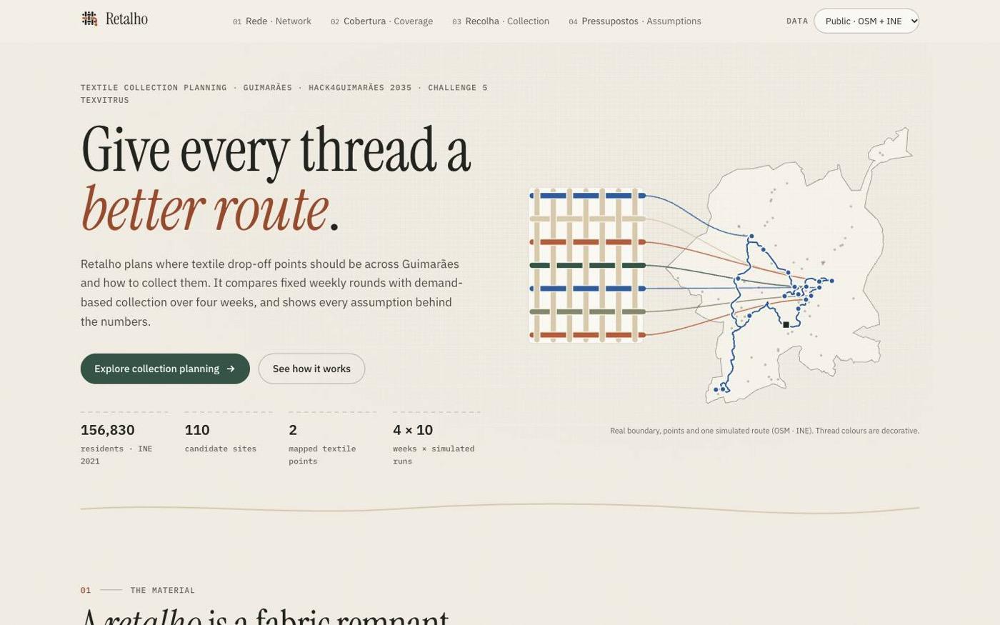
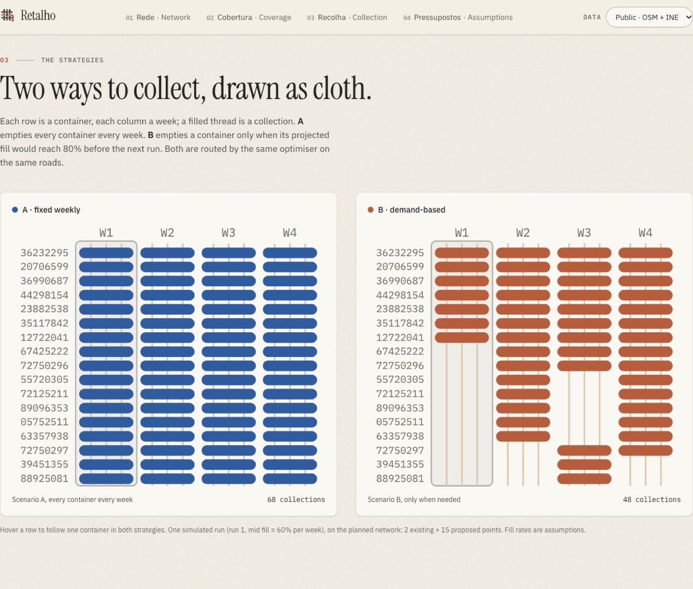
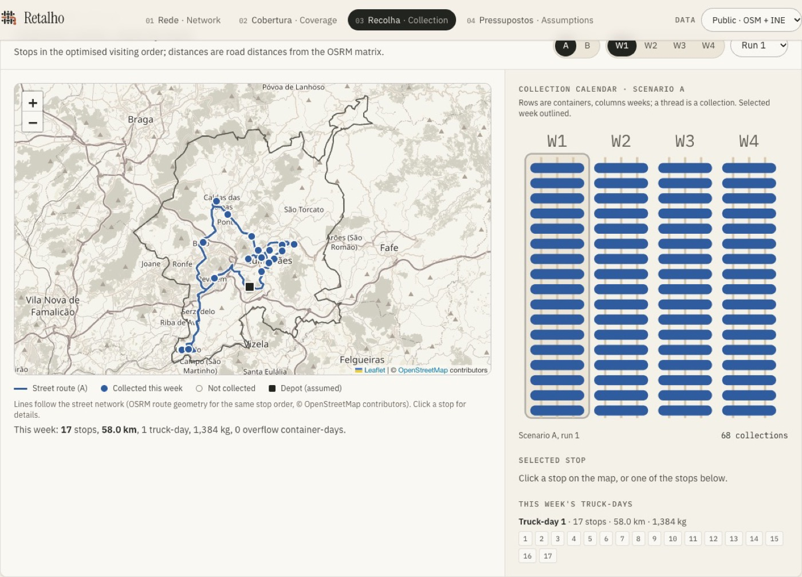
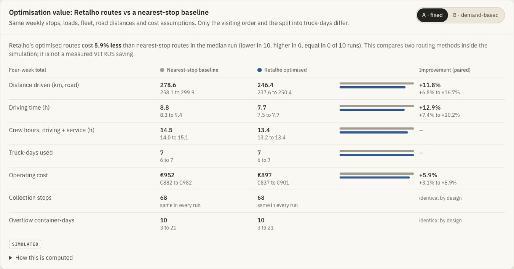
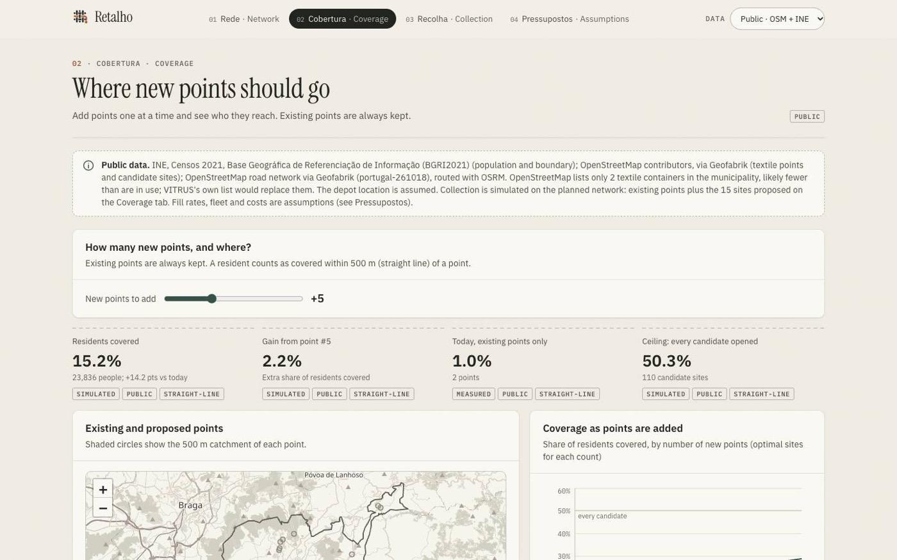
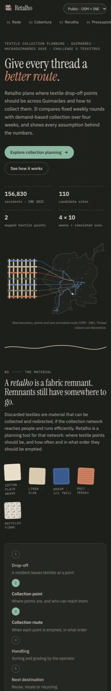
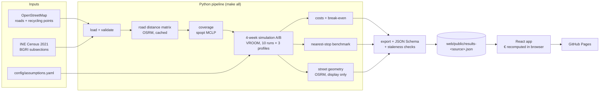

<p align="center">
  
</p>

<h1 align="center">Retalho</h1>

<p align="center"><b>Textile collection planning for Guimarães.</b><br>
Where textile drop-off points should be, and how to collect them: fixed weekly rounds against demand-based collection over four weeks, with every assumption visible.</p>

<p align="center">
  <a href="https://bhavya-jpg.github.io/retalho/"><b>Live demo</b></a> ·
  <a href="#run-it-locally">Run it locally</a> ·
  <a href="#how-it-works">How it works</a> ·
  <a href="#data-and-provenance">Data and provenance</a> ·
  <a href="#limitations">Limitations</a>
</p>

Built for **Hack4Guimarães 2035, Challenge 5: TexVitrus**. In Portuguese, a *retalho* is a remnant of fabric. The project treats discarded textiles as material that still has a next destination, if the collection network reaches people and runs efficiently.



---

## Contents

- [Overview](#overview)
- [Live demo](#live-demo)
- [Features](#features)
- [Visual design](#visual-design)
- [Tech stack](#tech-stack)
- [How it works](#how-it-works)
- [Data and provenance](#data-and-provenance)
- [Results so far](#results-so-far)
- [Run it locally](#run-it-locally)
- [Testing and CI](#testing-and-ci)
- [Deployment](#deployment)
- [Repository layout](#repository-layout)
- [Limitations](#limitations)
- [Roadmap](#roadmap)
- [Licences and credits](#licences-and-credits)

## Overview

**The problem.** Textile collection needs two decisions that pull against each other:
- **Coverage.** Collection points have to be close enough for residents to use.
- **Efficient collection.** Trucks should not drive to half-empty containers, nor leave full ones overflowing.

**Who it is for.** Planners at VITRUS, the operator behind Challenge 5, and anyone evaluating textile collection in Guimarães.

**What Retalho does**
- **Maps the network.** Shows existing textile points, candidate sites and the depot, and measures how many residents live within a chosen distance of a point.
- **Proposes new points.** Finds the best sites to add (a maximal covering location model), always keeping the existing ones.
- **Simulates four weeks** of collection on road distances for two strategies:
  - **A · fixed weekly rounds:** every container is emptied every week, on optimised routes. This is a fair baseline, not VITRUS's actual operation.
  - **B · demand-based collection:** a container is emptied only when its projected fill would reach a threshold *T* (80% by default) before the next weekly run.
- **Compares the strategies.** Shows km, crew hours, truck-days, operating cost, cost per tonne, overflow and textile left in containers, as a median and range over 10 simulated runs.
- **Checks the routing.** Benchmarks the optimised routes against a simple nearest-stop baseline on identical inputs.
- **Shows its working.** Every input and parameter displays its unit, source and status (measured, simulated, assumed or synthetic). Cost rates can be changed live.

**What Retalho does not do**
- It does not collect, sort, recycle or process textiles, and it does not track real collections.
- It holds no real-time data and no VITRUS operational data yet. All collection results are **simulations under stated assumptions**, not measured savings.

**Why transparency matters.** Most inputs are still estimates: fill rates, costs, fleet, and even the container list. A planning number is only useful if you can see what it rests on and change it. Retalho never presents an assumption as a fact, and each published result names the code commit that produced it.

## Live demo

**[bhavya-jpg.github.io/retalho](https://bhavya-jpg.github.io/retalho/)**. It is fully static, with no account, API key or server.

| Route | What to look at |
|---|---|
| `#inicio` | The story: material, city, strategies, evidence and transparency, using the real data |
| `#rede` · Network | Existing points, candidate sites, depot, today's coverage, distance checks |
| `#cobertura` · Coverage | The "+N new points" slider: sites, catchments, coverage gained per point |
| `#recolha` · Collection | Strategy comparison, routes on the map with a collection calendar, the benchmark, break-even |
| `#pressupostos` · Assumptions | Cost sliders, fill profile, every parameter with its source |

The header switches between the **public** dataset (OpenStreetMap + INE Census 2021, the default) and the **synthetic** demo dataset.

## Features

All of these are implemented and tested.

**Planning**
- **Coverage today and with +0…15 proposed sites.** spopt MCLP, solved exactly with CBC; existing points are always kept; population-weighted.
- **Four-week simulation of both strategies.** Identical fill draws, starting fills, matrix and fleet, checked by fingerprint, plus a mass-balance check on every run.
- **Fill profiles and break-even.** Three fill profiles (low, mid, high) and a seven-point sweep showing where demand-based collection stops paying.
- **Routing.** pyvroom routing with capacity, shift and service time, which never leaves a stop unserved and names the reason when it can't fit one.
- **Optimisation-value benchmark** against a deterministic nearest-stop router:
  - The four weeks are replayed with the baseline as router, so the stops, kilograms and overflow are identical.
  - Improvements are signed and never clamped, and shown as unavailable when the baseline is zero.

**Maps and routes**
- **Street-following route lines** from OSRM, in the optimiser's stop order. When street geometry is unavailable, routes fall back to **dashed** straight segments labelled approximate; dashes mean nothing else on the map.
- **Selectable stops.** Each shows its id, type, capacity, the weeks it was collected, and its truck-day and position in the route.
- **Route lists by truck-day,** where every stop is keyboard-accessible.
- **Collection calendar,** a "weave" of containers × weeks for the selected run, with the selected week and stop highlighted.
- **Works without base-map tiles.** When offline, boundary, points and routes stay exact on a plain background.

**Costs and transparency**
- **Live cost sliders** (€/km, €/crew-hour, €/truck-day). Costs are recomputed in the browser from simulated km, hours and truck-days, with the same formula as the Python model; parity is tested.
- **Labels on every figure:** Measured, Simulated, Assumption, Public, Synthetic data, Straight-line or Approx. distances.
- **A provenance banner on every view,** saying which inputs are public, synthetic or assumed.
- **A source report per dataset,** listing what changed between datasets.

**Product**
- **Landing story** with a hero drawn from real data and original textile diagrams.
- **Light and dark themes,** responsive down to 390 px, with no horizontal scrolling.
- **Always-on motion.** Animations run continuously by design, and content never depends on animation to be visible.
- **Single-file offline build** for a presentation laptop, with the data and fonts embedded.

## Visual design

The visual direction is **"tecido urbano" (urban fabric)**: the city's streets as warp, collection routes as weft. The research behind it, with sites inspected, measured motion and what was deliberately not copied, is in [docs/DESIGN_RESEARCH.md](docs/DESIGN_RESEARCH.md).

| | |
|---|---|
|  |  |
| **The collection weave.** One simulated run drawn as cloth: rows are containers, columns are weeks, a thread is a collection. | **Routes week by week.** Street routes on a warm paper map, next to the calendar for the same run. |
|  |  |
| **Optimisation value.** Same inputs, two routing methods, paired per run. | **Coverage.** Proposed sites and their 500 m catchments. |

<p align="center"><br><sub>Phone, dark theme</sub></p>

**Design system.** Tokens live in [web/src/index.css](web/src/index.css):

| Role | Token | Light | Notes |
|---|---|---|---|
| Canvas / surface | `--cotton`, `--ivory`, `--oat` | `#F3EFE6`, `#FAF8F2`, `#ECE6D9` | Undyed fibres; fibre-grain overlay |
| Ink | `--ink`, `--ink-2`, `--muted` | `#22241F`, `#4A4A42`, `#66645A` | All ≥ 5.1:1 on cotton |
| Accent | `--forest` | `#355447` | Buttons and links, never a data series |
| Strategy A | `--series-a` (indigo) | `#2F5C9E` (dark `#5F8AD0`) | Validated with B for chroma, colour-vision separation and contrast |
| Strategy B | `--series-b` (terracotta) | `#B65E3B` (dark `#D2724B`) | Marks only; text uses `--terracotta-ink` `#9A4A2C` |
| Lines and rules | `--flax`, `--border` | `#D8C8AC` | Woven grid, stitched seams |

- **Type.** Instrument Serif for display, IBM Plex Sans for the interface, IBM Plex Mono for ids, units and provenance. All OFL-1.1 and self-hosted.
- **Motion.** 150 / 300 / 600 / 900 ms tokens. Threads draw and reveals run once. Ambient loops (the hero truck, the shuttle glints, the ribbon, site ripples, the calendar playhead, pipeline packets and trucks on the map) are always on. There is no pause control, and the system's reduced-motion setting is not applied: a deliberate product choice that does not meet WCAG 2.2.2.
- **Accessibility.** An axe-core audit (WCAG 2.1 A/AA and best practice) of all five views in both themes reports no violations. That automated audit does not cover the pause requirement for moving content above. Strategies are always identified by label as well as colour, and the map has keyboard-accessible stop lists.

The logo is an original woven square whose loose thread leaves the cloth as a route and ends at a collection point. It doubles as the favicon.

## Tech stack

| Area | Technology |
|---|---|
| Frontend | [Vite](https://vite.dev/) 8, [React](https://react.dev/) 19, TypeScript 5.9, [Tailwind CSS](https://tailwindcss.com/) 4 |
| Maps | [Leaflet](https://leafletjs.com/) 1.9, used directly; OpenStreetMap tiles |
| Charts | [Recharts](https://recharts.org/) 3 |
| Fonts | @fontsource: Instrument Serif, IBM Plex Sans, IBM Plex Mono |
| Pipeline | Python 3.12+ (3.13 pinned), managed with [uv](https://docs.astral.sh/uv/) |
| Road distances and geometry | [OSRM](https://project-osrm.org/) v6 in Docker, on a [Geofabrik](https://download.geofabrik.de/) OpenStreetMap extract clipped with osmium |
| Vehicle routing | [pyvroom](https://github.com/VROOM-Project/pyvroom) (VROOM) 1.15 |
| Coverage optimisation | [spopt](https://pysal.org/spopt/) MCLP + [PuLP](https://coin-or.github.io/pulp/)/CBC |
| Geodata | GeoPandas, Shapely, pyproj, NumPy |
| Validation | jsonschema (results contract), PyYAML |
| Tests | pytest, Vitest, a headless-Chrome smoke test |
| CI and hosting | GitHub Actions, GitHub Pages |

No backend, database or API key is involved. The deployed site makes no routing or data API calls; its only external requests are the OpenStreetMap map tiles.

## How it works



1. **Load and validate** ([pipeline/load.py](pipeline/load.py)). Containers, candidates, demand points, depot and boundary are checked against a data contract: unique ids, inside the boundary, valid capacity and population, a source label on every record. Every problem is reported at once and nothing is written until all are fixed.
2. **Distances** ([pipeline/matrix.py](pipeline/matrix.py)). Road distance and car travel time come from a local OSRM server, cached by points and OSM data version. If OSRM is unavailable, a straight-line × detour-factor fallback is used, labelled `approx` everywhere. Each run checks that no road distance is shorter than the straight line.
3. **Coverage** ([pipeline/coverage.py](pipeline/coverage.py)). The population share within `coverage_radius_m` (straight line) of a point, and the optimal +N additions.
4. **Simulation** ([pipeline/simulate.py](pipeline/simulate.py)).
   - **Fill model.** Each container's average weekly fill is drawn from a gamma distribution for the chosen profile, with week-to-week noise; fill accumulates daily, and overflow is counted per container-day.
   - **Routing.** Each week's collections are routed by [pipeline/solve.py](pipeline/solve.py) with pyvroom, minimising the same cost model the app reports.
5. **Costs** ([pipeline/cost.py](pipeline/cost.py), mirrored in [web/src/lib/cost.ts](web/src/lib/cost.ts)). Cost = km × €/km + crew hours × €/h + truck-days × €/day. Savings of B over A are paired by run.
6. **Benchmark** ([pipeline/benchmark.py](pipeline/benchmark.py)). Replays the weeks with a nearest-stop router under identical constraints.
7. **Geometry** ([pipeline/geometry.py](pipeline/geometry.py)). OSRM street paths for each distinct stop sequence, validated, cached and simplified. Display only: neither order nor distance changes.
8. **Export** ([pipeline/export.py](pipeline/export.py)). Assembles one JSON file per dataset, validates it against [schema/results.schema.json](schema/results.schema.json), refuses stale inputs, and records the source commit.

The browser loads only static JSON. All euro figures are computed client-side from physical quantities, which is why the cost sliders respond instantly and why no backend is needed.

## Data and provenance

| Input | Public dataset (default) | Label |
|---|---|---|
| Boundary | Union of INE BGRI 2021 subsections for Guimarães (municipality code 0308) | Public |
| Population | 2,382 census subsections, **156,830 residents** (INE Censos 2021) | Public |
| Existing textile points | OpenStreetMap `recycling:clothes=yes`: **only 2** inside the municipality | Public |
| Candidate sites | 110 other OSM recycling containers, de-duplicated within 15 m | Public |
| Depot | Assumed location ([config/public_source.yaml](config/public_source.yaml)) | Synthetic |
| Roads | OSM via Geofabrik (Portugal, 18 Oct 2026), routed with OSRM | Public |

OpenStreetMap almost certainly lists fewer textile containers than VITRUS operates. Collection is therefore simulated on a **planned network**: the existing points plus the 15 sites the coverage optimiser proposes. This is set by `collection_network_new_points`; 0 means existing points only.

The **synthetic dataset** ([pipeline/synthetic.py](pipeline/synthetic.py), seed 2035) has 30 containers, 60 candidates and 400 demand points, all generated and labelled synthetic throughout. It demonstrates the method on a denser network and does not describe Guimarães.

**Assumptions.** All 20 model parameters are in [config/assumptions.yaml](config/assumptions.yaml), each with a value, unit, source and note:
- **Calibrated from public data:** the detour factor (1.42) and fallback speed (45 km/h), from OSRM on the real points.
- **Placeholders (the other 18):** container capacity, fill profiles, threshold, fleet, shift, service time, truck speed and all costs. They await VITRUS values.

**VITRUS data** has not been supplied. [docs/VITRUS_DATA.md](docs/VITRUS_DATA.md) describes the intake:
- `make vitrus-init` prepares the git-ignored `data/raw/vitrus/` folder without inventing anything.
- `make all SOURCE=vitrus` reruns everything.
- A source report lists which inputs and assumptions changed.

## Results so far

Simulated, from results commit `bdefe0f`, public dataset unless noted. These are model outputs under the assumptions above, not measured VITRUS operations.

| Question | Result (median over 10 runs) |
|---|---|
| Residents within 500 m of a mapped textile point today | 1.0% (2 OSM points: Measured) |
| … with +15 optimised sites | 28.9% (Simulated) |
| Operating cost of B vs A, mid fill (60%/week) | B 7.2% lower (range 1.7–11.3%); overflow: no extra container-days in the median run |
| Break-even sweep | B's saving falls from 60% at 20% weekly fill to under 1% at 110% |
| Optimised routes vs nearest-stop (cost) | 2.9–7.1% lower across profiles and scenarios; lower in all 60 runs |
| … synthetic dataset | 9.8–14.0% lower; lower in all 60 runs |

B also leaves more textile in containers at the end of the four weeks, which is why the app reports cost per tonne alongside total cost.

## Run it locally

**Requirements**
- [uv](https://docs.astral.sh/uv/)
- Node 20.19+ or 22.12+
- Docker, for OSRM and the public-data build only

**Just the app, using the committed results**

```sh
cd web && npm ci && npm run dev        # http://localhost:5173
```

**The full pipeline**

```sh
make install          # Python (uv) and web (npm) dependencies
make check-env        # versions, and proof that the VROOM and CBC solvers run
make osrm             # downloads the OSM extract once (426 MB), builds and starts OSRM on :5050
make public-data      # data/raw/public from OpenStreetMap + INE Census 2021
make all SOURCE=synthetic
make all SOURCE=public   # built last, so it is the app's default dataset
make web
```

`make all` runs, in order: matrix, coverage, simulation, cost and break-even, benchmark, geometry and export. `PROVIDER=osrm|approx|auto` chooses the distance source, and `make help` lists every target. Machines without a pyvroom wheel can use `make docker-check-env`, which runs the pipeline in a `python:3.12-slim` image.

## Testing and CI

```sh
make test                      # pytest: 151 tests
cd web && npx tsc -b           # type-check
cd web && npm test             # Vitest: 39 tests
cd web && npm run build && npx vite preview --port 4173 &  npm run smoke   # headless-Chrome smoke test
```

**What the tests cover**
- **Pipeline:** data validation, the distance matrix and its fallback, routing feasibility, simulation fairness and mass balance, the cost vectors, coverage, the benchmark edge cases (identical, better, worse, zero baseline), street-geometry fallbacks, the export schema and staleness checks, provenance, and the VITRUS readiness path.
- **TypeScript:** cost parity with Python, the route-drawing fallbacks, the benchmark maths, and the map and weave helpers.
- **Smoke test** (real interactions): the cost slider updates € within 100 ms, the A/B and week toggles redraw routes, table values equal the JSON, and the coverage slider shows exactly the proposed sites.

[.github/workflows/ci.yml](.github/workflows/ci.yml) runs on every push and pull request:

| Job | Steps |
|---|---|
| `pipeline` | `uv sync --frozen`, solver check, pytest |
| `web` | `npm ci`, `tsc -b`, Vitest, production build, smoke test of the build |
| `deploy` | `main` only, after both pass: deploys `web/dist` with `actions/deploy-pages` |
| `verify` | smoke test against the live URL |

## Deployment

**GitHub Pages**
- Deployed by CI on every push to `main`, with no secrets. The deploy job alone gets `pages: write` and `id-token: write`.
- One-time setting: *Settings → Pages → Source: GitHub Actions*.
- Vite builds with `base: "./"` and tabs are URL fragments, so the site works under `/retalho/` and page refreshes never hit a missing route.

**Other targets**
- **Presentation laptop:** `make offline` writes `web/dist-offline/retalho-offline.html` (about 3.8 MB). It opens by double-click with no server or network, with both datasets and all fonts embedded.
- **Any static host:** upload `web/dist/` after `make web-build`.

## Repository layout

```
config/        assumptions.yaml, synthetic.yaml, public_source.yaml, benchmarks.yaml
pipeline/      load, synthetic, public_data, matrix, solve, simulate, cost, coverage,
               benchmark, geometry, export, run_all, check_env
schema/        results.schema.json (the pipeline -> app contract)
scripts/       osrm.sh, public_data.sh, vitrus_init.sh, osmium.Dockerfile
tests/         pytest suites + fixtures (valid, broken, cost_vectors.json)
data/raw/      public/ (committed), synthetic/ and vitrus/ (git-ignored)
out/           results.json, source reports (generated)
web/           Vite app: src/{tabs,components,lib}, public/ (results JSON, favicon), scripts/ (smoke, offline)
docs/          DESIGN_RESEARCH.md, VITRUS_DATA.md, screenshots/
.github/       workflows/ci.yml
PLAN.md        the development plan, with a status log
```

## Limitations

- **No operator data yet.**
  - Fill rates, fleet, costs and the depot are assumptions.
  - OSM lists only 2 textile containers.
  - Every collection figure is a simulation on a planned network.
- **Weekly model.**
  - Collection happens at the start of each week; there is no within-week day assignment (the same for A and B).
  - Each truck runs one route per truck-day, with no mid-day unloading.
- **Travel times.** These are OSRM free-flow car times scaled by an assumed truck-speed factor, with no traffic.
- **B's planner** knows each container's average fill rate but not the weekly noise; real estimates would be noisier.
- **Coverage** uses straight-line distance, a walking proxy.
- **Cost sliders recompute, they don't re-route.** They recompute € on routes optimised with the default costs.
- **The benchmark** compares routing methods only. Nearest-stop is a simple baseline, not the best possible alternative.
- **Per-stop fill levels** are simulated inside the pipeline but not exported, so the stop details panel says so instead of showing a value.
- **Map tiles** need internet; everything else works offline.

## Roadmap

Planned, **not implemented**:
- **VITRUS data intake:** run the procedure in docs/VITRUS_DATA.md once data is supplied.
- **O1:** a "contentor cheio" (bin full) QR reporting page. This would need a small server.
- **O2:** coverage measured by walking routes.
- **A threshold-T sweep:** the cost-versus-overflow trade-off.

## Licences and credits

| Component | Licence |
|---|---|
| OpenStreetMap data (roads, recycling points, map tiles) | ODbL 1.0, © OpenStreetMap contributors |
| INE BGRI 2021 (boundary, population) | INE open data; reuse with source citation. Check INE's terms before redistributing. |
| OSRM, VROOM / pyvroom, Leaflet | BSD-2-Clause |
| spopt, Shapely, NumPy, GeoPandas | BSD-3-Clause |
| PuLP, PyYAML, jsonschema, pyproj, React, Vite, Tailwind CSS, Recharts, Vitest | MIT |
| CBC | EPL-2.0 |
| TypeScript | Apache-2.0 |
| Instrument Serif, IBM Plex Sans, IBM Plex Mono | SIL Open Font License 1.1 |
| osmium-tool (build tool in Docker, not shipped) | GPL-3.0 |

All application code was written during the hackathon (development started on 17 Oct 2026 with the organisers' approval). The team has not yet chosen a licence for Retalho's own code, so no licence file is included yet.
